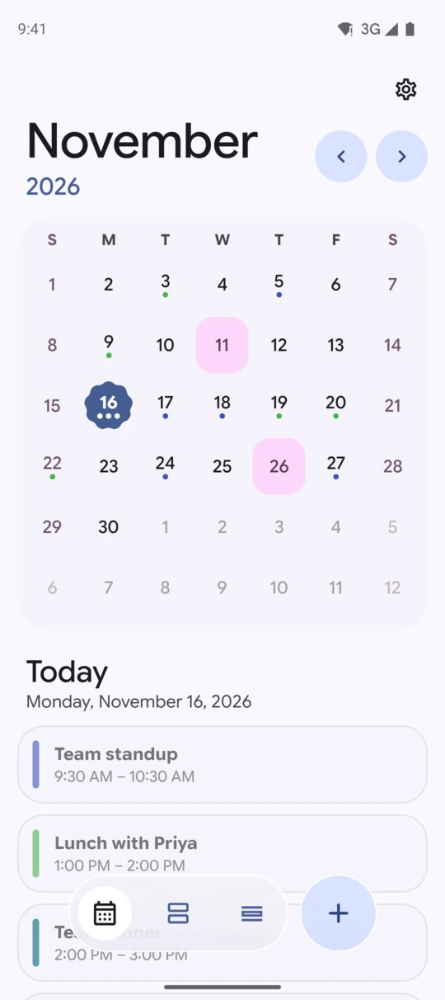
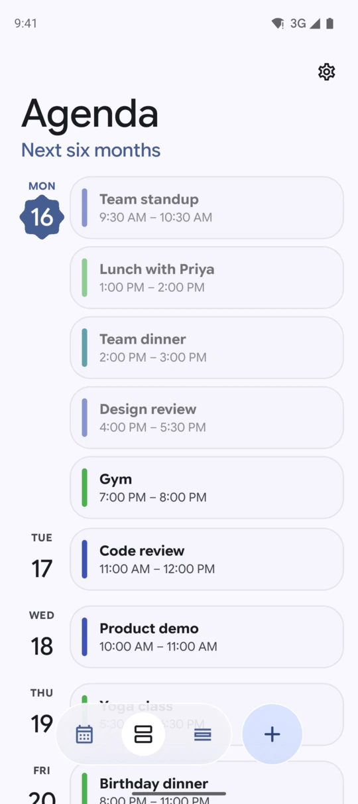
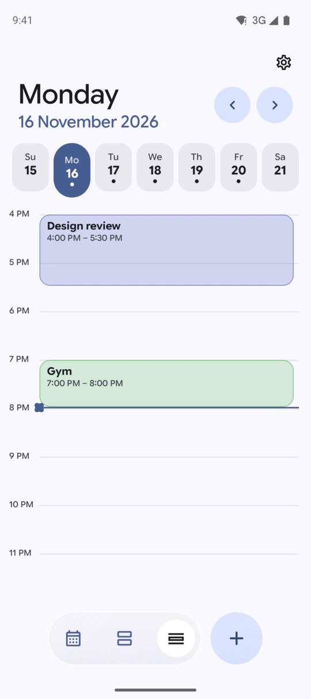
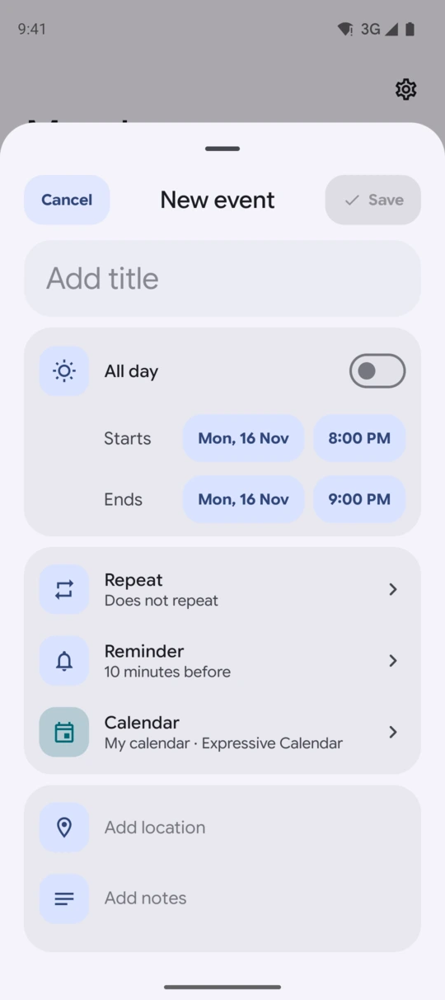
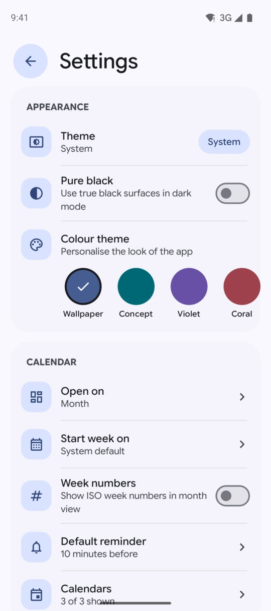
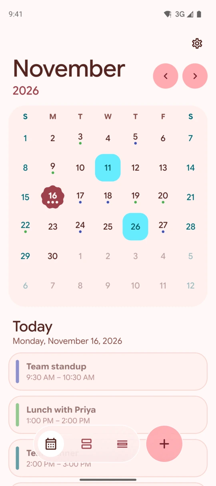
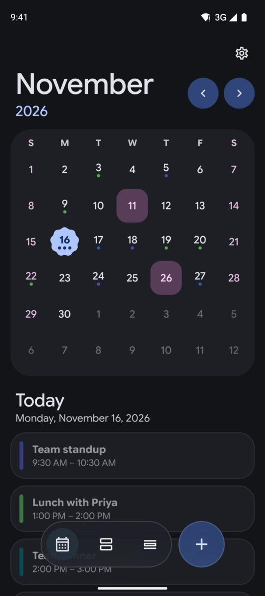
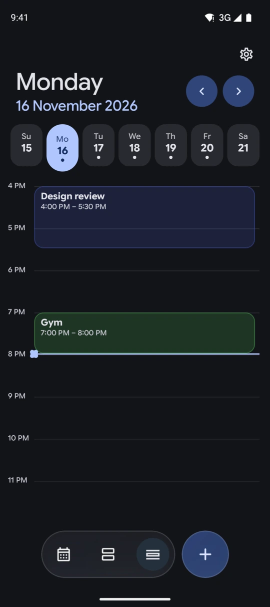

<div align="center">

# 📅 Expressive Calendar

**A calendar for Android built with Material 3 Expressive.**

Soft morphing shapes, frosted glass, variable type, and your events from the calendars already on your phone.

<br/>


</div>

---

## 📸 Screenshots

<div align="center">

<table>
  <tr>
    <td align="center"><br/><sub><b>Month</b></sub></td>
    <td align="center"><br/><sub><b>Agenda</b></sub></td>
    <td align="center"><br/><sub><b>Day</b></sub></td>
    <td align="center"><br/><sub><b>New event</b></sub></td>
  </tr>
  <tr>
    <td align="center"><br/><sub><b>Settings</b></sub></td>
    <td align="center"><br/><sub><b>Coral theme</b></sub></td>
    <td align="center"><br/><sub><b>Dark mode</b></sub></td>
    <td align="center"><br/><sub><b>Day, dark</b></sub></td>
  </tr>
</table>

</div>

## ✨ Highlights

| | |
|---|---|
| 🗓️ **Three views** | **Month**, **Agenda** and **Day**, one tap apart on a floating glass dock |
| 🔄 **Uses your existing calendars** | Reads and writes through Android's `CalendarContract`, so Google, Samsung and local calendars all sync through the accounts you already have. No new account, no cloud of its own |
| ✏️ **Event editor** | Cancel/Save bottom sheet with date and time pills, repeat rules, reminders and a calendar picker |
| 🔔 **Reminder notifications** | Alerts when a reminder is due, with Snooze, even on phones with no other calendar app (e.g. GrapheneOS). Stays off automatically if Google or Samsung Calendar already shows them |
| 🎉 **Public holidays** | For as many countries as you like, fetched from [Nager.Date](https://date.nager.at) and cached per country and year. A holiday shared by several countries shows once |
| 💾 **Backup** | Export calendars to an `.ics` file and import one back, from this app or Google Calendar, Thunderbird, Etar… Repeating events, time zones and reminders carry over; re-importing never duplicates |
| 🧩 **Home screen widget** | The month at a glance, with holidays and events |
| 🎨 **10 colour themes** | Wallpaper-based dynamic colour plus 9 presets: *Concept, Violet, Coral, Ember, Citron, Forest, Lagoon, Azure, Fuchsia* |
| 🌗 **Dark mode** | System, Light or Dark, with an optional pure-black AMOLED mode |
| 🔤 **Google Sans Flex** | A variable font with optical sizing, so headings look right at every size |
| 🍪 **Expressive shapes** | `MaterialShapes` (Cookie, Sunny, Soft Burst) and springy press feedback throughout |

## ⚙️ Settings

- **Week starts on:** system default, Saturday, Sunday or Monday
- **Default view:** Month, Agenda or Day
- **Default reminder:** none, at start, or anywhere from 5 minutes to 1 week before
- **Reminder notifications:** automatic (on unless another calendar app shows reminders), or forced on/off
- **Week numbers:** on or off
- **Holidays:** on or off, and any number of countries (searchable, with flags), or automatic from the phone's region
- **Backup:** import and export `.ics` files
- **Calendars:** choose which of your device calendars to show

## 🔐 Permissions

| Permission | Why |
|---|---|
| `READ_CALENDAR` / `WRITE_CALENDAR` | To show, create and edit events in your device calendars |
| `POST_NOTIFICATIONS` | To show reminder notifications (asked for only when they're on) |
| `USE_EXACT_ALARM` | So a 10-minute snooze rings after 10 minutes, not 17 |
| `INTERNET` | Only to download public holiday lists from `date.nager.at` |

There are no analytics, no ads and no trackers.

## 🚀 Getting started

### Requirements

- Android Studio (recent canary or preview that supports **AGP 9.2**)
- JDK 17+
- A device or emulator running **Android 8.0 (API 26)** or later

### Build and run

```bash
git clone https://github.com/Najeer-k11/expressive-calendar.git
cd expressive-calendar
./gradlew installDebug
```

The debug build installs as `com.ndev.expressive.calendar.debug`, so it can sit next to a release build.

### Release build

Signing is read from a git-ignored `keystore.properties` in the project root:

```properties
storeFile=/path/to/release.jks
storePassword=••••••
keyAlias=••••••
keyPassword=••••••
```

```bash
./gradlew assembleRelease
```

If `keystore.properties` is missing, the release build is produced unsigned. R8 minification and resource shrinking are on.

## 🏗️ Project structure

```
app/src/main/java/app/expressivecalendar/
├── MainActivity.kt
├── data/
│   ├── CalendarRepository.kt   # CalendarContract reads and writes
│   ├── HolidayRepository.kt    # Nager.Date fetch + on-disk cache
│   └── Settings.kt             # DataStore-backed preferences
├── ui/
│   ├── CalendarApp.kt          # App scaffold and navigation
│   ├── CalendarViewModel.kt
│   ├── CalendarDock.kt         # Floating glass dock
│   ├── Glass.kt                # Frosted glass backdrop
│   ├── Components.kt
│   ├── screens/                # Month, Agenda, Day, Settings, Permission
│   ├── sheets/                 # Event editor and detail sheets
│   └── theme/                  # Palettes, typography, MaterialExpressiveTheme
└── widget/
    └── MonthWidgetProvider.kt  # Home screen month widget
```

## 🧰 Tech stack

- **Kotlin 2.4** and **Jetpack Compose** (alpha Compose BOM `2026.07.01`)
- **Material 3 `1.5.0-alpha25`**, which provides the expressive components
- **AndroidX Graphics Shapes** for shape morphing
- **DataStore Preferences** for settings
- **AGP 9.2** with built-in Kotlin support

> [!NOTE]
> The project uses the **alpha** Compose BOM on purpose. Stable Material 3 ships the expressive theming but not the expressive components, and mixing an alpha `material3` with the stable BOM pulls in mismatched Compose versions. See `gradle/libs.versions.toml` for details.

## 🙏 Credits

- **[Rayane Bouafia](LICENSE)**, for the original *Expressive Clock* design system and theming this app is built on
- **Google**, for [Material 3 Expressive](https://m3.material.io/) and the [Google Sans Flex](https://fonts.google.com/specimen/Google+Sans+Flex) typeface (SIL OFL 1.1)
- **[Nager.Date](https://date.nager.at)** by Tino Hager, for the free public holiday API
- **The Android Open Source Project** and **JetBrains**, for Jetpack Compose, AndroidX and Kotlin

See [THIRD-PARTY-NOTICES.md](THIRD-PARTY-NOTICES.md) for full attributions.

## 📜 License

Released under the [MIT License](LICENSE).

Bundled fonts are under the SIL Open Font License 1.1. See [THIRD-PARTY-NOTICES.md](THIRD-PARTY-NOTICES.md) and [`licenses/`](licenses/).

<div align="center">
<br/>
<sub>Made with ☕ and Jetpack Compose</sub>
</div>
